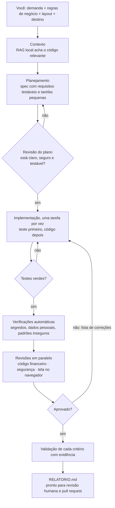

# Orquestrador BP


**Um time de agentes de IA que entrega software sozinho, com qualidade e segurança de banco.**

Você escreve uma mensagem com o que precisa ser feito. O orquestrador planeja, implementa com testes, revisa o código como uma instituição financeira revisaria, testa a tela no navegador e devolve um relatório pronto para revisão humana. Sem pedir mais nada no meio do caminho.

Ele roda sobre o [Kiro](https://kiro.dev), o ambiente de agentes de programação da AWS, e foi pensado para ambientes corporativos fechados: sem MCP, sem internet para o agente e sem instalar nenhuma ferramenta além do Node.js.

> Projeto independente, criado para uso em ambiente de previdência complementar ("BP" vem de Brasilprev, o contexto para o qual foi desenhado). Não é um produto oficial nem endossado pela Brasilprev ou pela AWS.

---

## Como funciona, em uma imagem



Cada caixa é uma etapa do **workflow nativo do Kiro** e roda com um agente especializado, em uma sessão limpa, com o modelo de IA mais adequado para aquele trabalho.

## As ideias principais

**1. O modelo certo para cada tarefa.** Pensar bem custa caro; digitar código simples, não. Por isso cada papel usa um modelo diferente:

| Papel | Modelo | Custo relativo |
| --- | --- | --- |
| Coordenar e rodar comandos | Claude Haiku | 0,4x |
| Implementar o dia a dia | Claude Sonnet 5.5 | 1,3x |
| Planejar, revisar e mexer em dinheiro ou segurança | Claude Opus 5.5 | 2,0x |

O plano classifica o risco de cada tarefa (por exemplo, "cálculo de imposto no resgate" é risco alto) e o despachante entrega para o executor certo: rápido, padrão ou crítico.

**2. Gastar poucos tokens sem perder qualidade.** Cada etapa começa sem o histórico das anteriores. O agente recebe só os trechos de código que importam (com limite de tamanho), os testes devolvem só as falhas e tudo que dá para verificar com um script, como segredos no código ou testes desligados, é verificado sem chamar a IA.

**3. Não fazer duas vezes.** O plano é revisado antes de qualquer linha de código. As regras de negócio e o layout viram critérios de aceite testáveis, e no final cada critério precisa de uma evidência real: o nome do teste que o prova.

**4. Autonomia de verdade.** Depois da primeira mensagem, ninguém precisa responder nada. Se faltar informação, o orquestrador escolhe a opção mais conservadora e registra a premissa no relatório para você validar.

**5. Segurança que não depende da boa vontade da IA.** O agente é tratado como não confiável (ele pode ser enganado por um texto numa página ou num arquivo). Por isso a proteção vem de barreiras que ele não atravessa: permissões mínimas por agente, sandbox sem rede e um estado assinado que ele não consegue falsificar. Detalhes em [Segurança](#segurança).

## Como foi montado

O projeto foi construído em quatro passos:

1. **Leitura da documentação inteira do Kiro** (305 páginas): agentes, subagentes, workflows, hooks, permissões, sandbox, skills, modelos e governança corporativa. A decisão central saiu daí: usar só recursos nativos do Kiro, porque os termos de uso dele proíbem ferramentas que chamem os modelos por fora.
2. **Auditoria do [Browser Use](https://github.com/browser-use/browser-use)** (MIT), para trazer o controle de navegador sem MCP. A técnica de leitura da página foi reescrita do zero e tudo que era arriscado ficou de fora: telemetria, extensões baixadas, execução de código arbitrário e aceite automático de confirmações.
3. **Ferramenta própria em Node.js puro**, com zero dependências, que fornece aos agentes o que o Kiro não tem pronto.
4. **Revisão de segurança independente**, que tentou quebrar tudo e encontrou 17 falhas reais. Todas foram corrigidas, e cada uma virou um teste automatizado.

## Tecnologias

| Peça | Tecnologia | Para quê |
| --- | --- | --- |
| Motor dos agentes | Kiro: custom agents, workflows, hooks, steering, skills, sandbox | executar e coordenar os agentes |
| Ferramenta `bp` | Node.js 20+ só com a biblioteca padrão | estado, verificações, RAG, navegador |
| Busca no código (RAG) | BM25 + vetores TF-IDF de trigramas, fundidos por Reciprocal Rank Fusion | achar o código relevante sem baixar modelo |
| Navegador | Chrome ou Edge já instalados, Chrome DevTools Protocol por pipe | testar telas sem MCP e sem porta aberta |
| Integridade | HMAC-SHA256 com chave fora do projeto | impedir que o agente falsifique resultados |
| Auditoria | registro com hash encadeado e âncora assinada | detectar qualquer alteração na trilha |
| Testes | `node:test` | 71 testes, inclusive com navegador real |

## Usando

### Requisitos

- Kiro IDE 1.x ou Kiro CLI V3
- Node.js 20.11 ou mais novo
- Chrome ou Edge (para os testes de tela)
- Git (recomendado)

### 1. Instalar no seu repositório

Feito por uma pessoa, num terminal (o comando recusa execução por agente):

```bash
git clone https://github.com/matheusasg09/orquestrador-bp.git
node orquestrador-bp/bin/bp.mjs init --destino caminho/do/seu-projeto
cd caminho/do/seu-projeto
node .bp/bp.mjs doutor
```

Isso cria no projeto a pasta `.kiro/` (13 agentes, 12 skills, hooks, workflows e configurações) e a pasta `.bp/` (ferramenta, política de modelos e configuração). Nada existente é sobrescrito sem `--forcar`, e o que for substituído ganha backup.

### 2. Ajustar para o seu projeto

Em `.bp/config.json`, informe o comando dos testes e, se houver tela, o comando e o endereço da aplicação:

```json
{
  "testes": { "comandos": [["npm", "test"]] },
  "aplicacao": { "comando": ["npm", "run", "dev"], "url": "http://localhost:3000" }
}
```

Em `.bp/modelos.json`, ajuste os modelos aprovados pela sua empresa e rode `node .bp/bp.mjs modelos aplicar`.

Depois abra o projeto no Kiro e escolha **confiar no workspace** (sem isso o Kiro não carrega os agentes do repositório).

### 3. Pedir uma entrega

No Kiro, com o agente `bp-orquestrador`, envie uma única mensagem:

```text
Demanda: permitir resgate parcial no portal do participante.
Regras de negócio: mínimo de R$ 100,00; respeitar a carência do plano; IR conforme o regime do participante.
Layout: tela com saldo, campo de valor, resumo com IR estimado e botão "Confirmar resgate".
Destino: módulo portal-participante e servico-resgate.
```

Pronto. O resultado aparece em `.bp/estado/execucao/RELATORIO.md`, e as mudanças ficam no seu diff para revisão. O agente nunca faz push.

Também existe o modo sem tela, para terminal ou CI:

```bash
node .bp/bp.mjs iniciar --demanda-arquivo demanda.md --regras-arquivo regras.md --layout-arquivo layout.md
```

Para corrigir um defeito, use o workflow `bp-correcao`; para só revisar mudanças, `bp-revisao`.

### Comandos úteis

| Comando | O que faz |
| --- | --- |
| `node .bp/bp.mjs exec status` | mostra as tarefas e a fase atual |
| `node .bp/bp.mjs testes` | roda os testes e mostra só as falhas |
| `node .bp/bp.mjs portoes` | procura segredos, dados pessoais e padrões inseguros |
| `node .bp/bp.mjs rag contexto "resgate parcial"` | busca o código relevante |
| `node .bp/bp.mjs nav abrir http://localhost:3000` | abre o navegador controlado |
| `node .bp/bp.mjs tokens relatorio` | mostra onde os tokens foram gastos |
| `node .bp/bp.mjs auditoria verificar` | confere a integridade da trilha |
| `node .bp/bp.mjs ajuda` | lista todos os comandos |

## Segurança

O que impede um agente enganado de causar dano:

- **Permissões mínimas:** cada agente só pode fazer o que o papel dele exige; revisores, por exemplo, não alteram código. Em modo automático, tudo que não está liberado é negado.
- **Sandbox obrigatório:** os comandos do agente rodam sem acesso à internet e sem permissão de escrita nas configurações do orquestrador.
- **Estado assinado:** "testes verdes", "revisão aprovada" e "tarefa concluída" são assinados com uma chave guardada fora do projeto. Um arquivo forjado é recusado.
- **Navegador isolado:** todo o tráfego passa por um filtro que só deixa sair para os endereços permitidos (por padrão, só `localhost`).
- **Proteção de dados:** CPF, CNPJ, cartão e segredos são mascarados em tudo que o orquestrador mostra ou guarda.
- **Defesa extra:** hooks que bloqueiam comandos perigosos e verificações que reprovam código com segredo, dado pessoal real ou padrão inseguro.

Os riscos que continuam existindo, como o fato de o agente executar os testes que ele mesmo escreve, estão descritos com franqueza em [docs/SEGURANCA.md](docs/SEGURANCA.md).

## Estrutura do repositório

```text
bin/bp.mjs              ponto de entrada da ferramenta
src/                    código da ferramenta (estado, RAG, portões, navegador, hooks...)
modelo/                 o que é instalado no projeto: .kiro/ e .bp/
  .kiro/agents/         os 13 agentes e suas permissões
  .kiro/workflows/      entrega, correção de defeito e revisão
  .kiro/skills/         conhecimento especializado carregado sob demanda
  .bp/prompts/          as instruções de cada agente
test/                   71 testes automatizados
docs/                   arquitetura, segurança, modelos, navegador, operação
ferramentas/            gerador das regras de permissão dos agentes
```

## Para quem quer contribuir

```bash
npm test          # todos os testes (os de navegador são pulados se não houver Chrome ou Edge)
npm run verificar # o orquestrador passa pelas próprias verificações de segurança
```

## Documentação

- [Arquitetura](docs/ARQUITETURA.md): fluxo, agentes e decisões técnicas
- [Segurança](docs/SEGURANCA.md): ameaças, barreiras e riscos residuais
- [Modelos e tokens](docs/MODELOS-E-TOKENS.md): política de modelos e técnicas de economia
- [Navegador](docs/NAVEGADOR.md) e [auditoria do Browser Use](docs/AUDITORIA-BROWSER-USE.md)
- [Governança no Kiro](docs/GOVERNANCA-KIRO.md): configurações recomendadas para administradores
- [Operação](docs/OPERACAO.md): uso diário e solução de problemas
- [Fontes](docs/FONTES.md): páginas da documentação do Kiro consultadas

Créditos de terceiros em [THIRD_PARTY_NOTICES.md](THIRD_PARTY_NOTICES.md).
